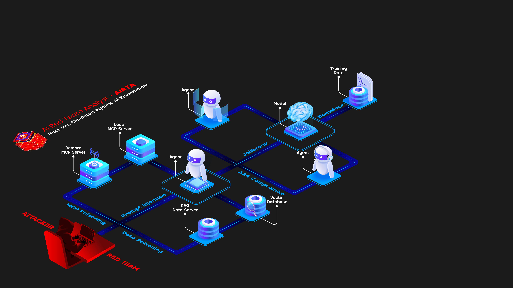
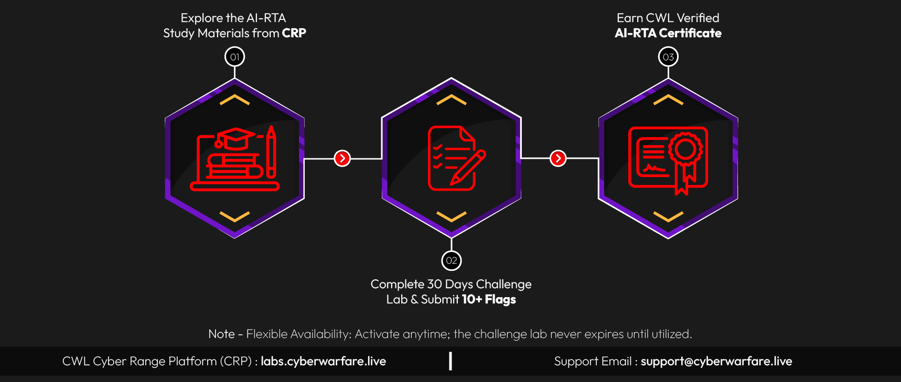

# AI Red Team Analyst (AI-RTA) - CyberWarFare Labs

Este repositório serve como registro da conclusão da certificação **AI Red Team Analyst (AI-RTA)**. 

## 📚 Sobre a Certificação
O **AI-RTA** é um curso prático (hands-on) projetado para construir habilidades reais em segurança de IA, LLMs e GenAI. O laboratório cobre tópicos essenciais como *prompt injection*, segurança de MCP (Model Context Protocol), ataques a RAG (Retrieval-Augmented Generation), exploração de modelos e frameworks da indústria como **MITRE ATLAS** e o **OWASP Top 10 for LLMs**.

### 🏗️ Arquitetura do Laboratório
O ambiente simula uma infraestrutura corporativa real de IA, onde um atacante (Red Team) deve contornar múltiplas camadas de defesa:

### 🎓 Procedimento de Certificação
A conquista da certificação exige a conclusão de um laboratório prático de 30 dias e a captura de mais de 10 flags em diferentes cenários de ataque.

---

## 🛡️ Habilidades Práticas Demonstradas

Durante o exame prático, foram exploradas e aplicadas as seguintes técnicas:

*   **Manipulação de Agentes Autônomos:** Exploração de ferramentas internas de agentes de IA para realizar ataques de SSRF (Server-Side Request Forgery) e acessar APIs internas restritas.
*   **Bypass de Guardrails:** Testes de estresse em filtros de segurança (Safety Filters) e manipulação de System Prompts.
*   **Pivô e Isolamento de Rede:** Contorno de ambientes isolados (containers) e movimentação lateral para alcançar a infraestrutura interna real.
*   **Exfiltração de Dados:** Uso da interação com o agente como vetor para comprometer o cluster de gerenciamento.

## 📂 Documentação Adicional

Para ver o escopo detalhado do laboratório e as perguntas abordadas em cada um dos 10 desafios, acesse o arquivo:
👉 **[Escopo do Laboratório (Questões)](./LAB_SCOPE.md)**

> *Nota: Por respeito às políticas de segurança e aos termos de uso da CyberWarFare Labs, o passo a passo detalhado (Walkthrough) e as respostas (Flags) foram intencionalmente omitidos deste repositório público.*

---
**Concluído em:** Outubro de 2026
